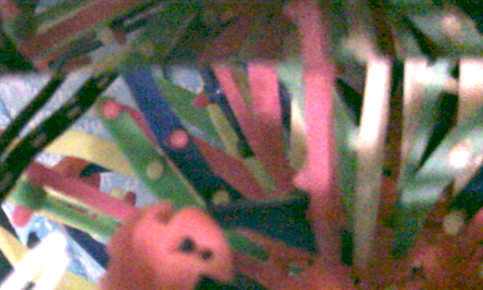

# ACZ702 camera pipeline — OV5640 → DDR3 → 800×480 TFT

Board: 芯路恒 ACZ702 (Zynq-7020, `xc7z020clg400-1`), OV5640 module on the DVP camera
header, 4.3" 800×480 RGB TFT (WKS43189 class), Vivado / Vitis 2023.2.

A live camera monitor built as a real double-buffered pipeline: the OV5640 is
configured over SCCB by the PL, its DVP output is packed into 64-bit words, two
800×480 RGB565 frame buffers live in DDR3 (reached through `S_AXI_HP0`), and the PL
times them out to the panel at 1056×526 @ 33.333 MHz (60.0 Hz).  The PS supplies
DDR3, the 50 MHz AXI clock and a control/status word pair — nothing else.



*Live camera frame read back out of DDR3 over JTAG (`ps/dump_fb.tcl` + `tools/fb2png.py`).
The camera sits a few centimetres from a tangle of cables on the desk, so the picture is
an out-of-focus close-up; this is the raw dump with a 3.2× gain and 0.65 gamma applied
because the room is dim — `docs/frame.png` is the unmodified dump.*

```
  OV5640 (DVP, 800x480 RGB565, PCLK ~42 MHz)
     |
     |  camera_pclk domain
     v
  ov5640_capture    byte pairing, 800x480 clipping, 4 pixels/64-bit word,
     |              tag bit = "first word of a frame"
     v
  afifo64 (65 bit)  dual-clock, show-ahead, Gray pointers       <-- CDC #1
     |
     |  clk50 (PS FCLK0) domain
     v
  fb_ddr            AXI4 master, 128-byte bursts -> S_AXI_HP0 -> DDR3
     |               write: buffer A while the panel reads B, tag-driven switch
     |               read:  retargeted only in vertical blanking, no tearing
     v
  afifo64 (64 bit)  dual-clock                                  <-- CDC #2
     |
     |  33.333 MHz pixel domain
     v
  lcd_display       1056x526 timing, HSYNC/VSYNC negative, DE high, RGB565
     |
     +--> TFT ribbon (U15/W15/U14/W14 + 16 data pins)
     +--> SiI9022A (same pins) -> HDMI
```

The PS is not in the video path.  It only

* runs `ps7_init` (DDR3 controller, clocks, UART1),
* writes `ctrl` — test pattern, freeze, backlight duty,
* reads `status_cam` / `status_disp` — camera init/streaming, frame rates, frame
  counters, underruns, AXI errors,
* prints one status line per second on the CH343P console and accepts single-key
  commands.

## What you see

The panel shows the camera picture, 800×480, 60 Hz refresh from a ~30 fps camera
(each camera frame is shown twice).  The PL LED blinks slowly while video is
running and fast when it is not.  The console reports:

```
 ACZ702 camera pipeline - OV5640 -> DDR3 -> TFT
 800 x 480 RGB565, two frame buffers in DDR
 ...
OV5640 configured, waiting for the first frames...
cam init=1 live=1 fps=26 frames=37 | panel frames=81 underruns=0 errs=0 | bl=100% camera live
cam init=1 live=1 fps=30 frames=67 | panel frames=141 underruns=0 errs=0 | bl=100% camera live
```

| Key | Action |
|---|---|
| `p` | test pattern (8 colour bars + white frame) instead of the camera |
| `f` | freeze / resume the frame buffer |
| `b` | cycle the backlight 100 / 60 / 30 / 10 % |
| `i` | dump the control and status words, resolution and buffer addresses |
| `h` | help |

## Frame buffers

| Buffer | Address | Size |
|---|---|---|
| 0 | `0x0180_0000` | 768 000 bytes |
| 1 | `0x018B_B800` | 768 000 bytes |

**Why double buffering.** A single buffer written by the camera and read by the
panel at two unrelated rates tears: the beam reads whatever the camera has
written so far.  Here the camera fills one buffer while the panel reads the other,
and the switch happens **once per panel frame, at the start of vertical
blanking** — the read address is retargeted, the stale prefetch is drained and the
FIFO is refilled, all inside the ~1.4 ms blanking interval.  The panel therefore
never shows a half-written frame, and the picture does not roll.

**Why the frame boundary is a tag, not a clock-domain signal.** The first pixel
word of every camera frame carries bit 64 through the FIFO.  When that word
reaches the head of the FIFO the DDR engine switches buffer and resets its burst
counter — no synchroniser, no "did the toggle arrive in time" race, and the frame
always starts at offset 0 even if a few words of the previous frame were still
queued.

**Bandwidth.** Write 800×480×2×30 fps = 23 MB/s, read 46 MB/s; the 50 MHz / 64-bit
AXI master can move 400 MB/s, and each burst is 16 beats (128 bytes), the maximum
AXI3 burst the HP port accepts.  Bursts never cross a 4 KB boundary (768 000 =
6000 × 128 bytes).

## Adding image processing

The project is named for the *pipeline* rather than the sensor: the video path is
deliberately split so a processing stage has three clean insertion points.

| Insertion point | Clock | Granularity | Use it for |
|---|---|---|---|
| between `u_capture` and `u_cam_fifo` (`ov5640_top.v`) | camera PCLK 42 MHz | one 64-bit word = 4 RGB565 pixels | line-buffered kernels: 3×3 Sobel / median / gaussian, colour balance |
| inside `fb_ddr`, between the read burst and `disp_data` | AXI 50 MHz | 64-bit word stream out of DDR | per-word effects on the display side, and anything that must keep the stored frame raw |
| inside `lcd_display`, before `lcd_rgb` | pixel 33.3 MHz | one pixel | cheap overlays (freeze marker, histogram, crosshair, test patterns) |

Invariants a write-side stage must keep, otherwise the DDR engine's address
counter drifts and the picture slides:

* **96 000 words per frame** (800 × 480 / 4) and **200 words per line**;
* the **frame tag (bit 64)** stays on the first word of every frame;
* word alignment is **4 pixels**, restarted at every line and frame (the packer
  does this; a filter that delays pixels must delay the tag by the same amount).

For a mode switch, wire it to a reserved control bit (`ctrl[2]` … `ctrl[7]`) and
report the active mode in a reserved status bit (`status_cam[7:2]`), then add a
console key next to `p`/`f`/`b` in `ps/app/main.c`.

Line-buffer budget at the camera rate: 4 pixels/cycle, 800 pixels/line = 200
words/line, so a 3×3 kernel needs two line buffers (≈ 3 BRAM36) and about
1 500 LUTs for three 8-bit channels.

## Clock domains

| Domain | Source | Used by |
|---|---|---|
| `clk50` | PS FCLK0 | AXI master, DDR engine, I2C camera init, HDMI init, 1 Hz counters |
| `camera_pclk` | OV5640 (M17) | DVP capture + packer (42 MHz for this mode) |
| `clk_pix` | MMCM 50 → 33.333 MHz | panel timing and pixel readout |
| `clk_cam` | MMCM 50 → 24.000 MHz | OV5640 XVCLK (the register table assumes 24 MHz) |

MMCM: VCO 1200 MHz (M = 24), CLKOUT0 /36, CLKOUT1 /50.

## Files

| Path | Purpose |
|---|---|
| `rtl/ov5640_top.v` | top: resets, clocks, control/status words, backlight PWM, LED, HDMI init |
| `rtl/ov5640_capture.v` | DVP byte pairing, 800×480 clipping, 4-pixel packer, frame tag |
| `rtl/afifo64.v` | 65/64-bit dual-clock show-ahead FIFO (Gray pointers) |
| `rtl/fb_ddr.v` | AXI4 master: tag-driven DDR write engine + blanking-time read engine |
| `rtl/lcd_display.v` | 1056×526 timing, RGB565 output, reload handshake, underrun counter |
| `rtl/clk_gen.v` | MMCM 33.333 MHz + 24 MHz |
| `rtl/camera_init.v`, `rtl/i2c_control.v`, `rtl/i2c_bit_shift.v`, `rtl/ov5640_init_table_rgb.v` | OV5640 SCCB bring-up (vendor reference design, see Provenance) |
| `rtl/sii9022_init.v`, `rtl/sii9022_init_table.v` | HDMI transmitter set-up on the PL I2C bus |
| `constr/ov5640.xdc` | camera header, panel, LED, backlight, HDMI I2C, clock constraints |
| `ps/build_hw.tcl` | block design (PS7 + HP0 + 2 AXI GPIO + SmartConnect + PL top), bitstream, XSA |
| `ps/build_app.tcl` | Vitis platform, BSP, application build |
| `ps/run_app.tcl` | JTAG download of bitstream + `ps7_init` + ELF |
| `ps/dump_fb.tcl` | read a live frame buffer out over JTAG (proof without a screen capture) |
| `ps/restart_app.tcl` | reset the PS and re-run the loaded application |
| `ps/impl_pre.tcl` | implementation hook: CLOCK_DEDICATED_ROUTE waiver for the camera PCLK pin |
| `ps/impl_iterate.tcl` | re-run place & route on the existing project (iteration helper) |
| `ps/app/main.c` | status console and key commands |
| `sim/tb_pipeline.v` | self-checking end-to-end video test (reduced geometry + AXI memory model) |
| `sim/tb_lcd_timing.v` | full-size panel timing check |
| `sim/run_sim.ps1` | rebuild and run both simulations |
| `tools/fb2png.py` | RGB565 DDR dump → PNG |
| `tools/serial_send.ps1`, `tools/serial_capture.ps1` | drive / record the console |
| `tools/verify.ps1` | hardware self-check: live-frame and freeze tests |
| `tools/frame_stats.py` | frame-dump statistics (mean, dark fraction, row variation, A/B compare) |
| `docs/` | console transcripts and frame dumps rendered to PNG |

## Build

```powershell
cd D:\Programs\tests\fpga\camera_pipeline

# 1. bitstream + XSA  (prints "IMPL STATUS: ... write_bitstream Complete!")
& D:\Xilinx\Vivado\2023.2\bin\vivado.bat -mode batch -source ps/build_hw.tcl `
      -log ps/build_hw.log -journal ps/build_hw.jou

# 2. bare-metal application
& D:\Xilinx\Vitis\2023.2\bin\xsct.bat ps/build_app.tcl
```

## Run

Leave the boot-mode switch on **JTAG**, open COM3 (CH343P) at 115200 8N1, then:

```powershell
& D:\Xilinx\Vitis\2023.2\bin\xsct.bat ps/run_app.tcl
powershell -File tools/serial_send.ps1 -Text "h" -ReadSeconds 2
```

The panel lights up with the camera image within about a second of the ELF
starting (the PL waits ~1.05 s before the SCCB writes, as the OV5640 needs its
power-up delay).

`ps/restart_app.tcl` resets the PS and re-runs the already loaded application
(no bitstream, no ELF download) when only the software changed.  Every JTAG
script starts by killing a stale `hw_server`: a server left over from an earlier
session keeps a dead handle on the cable and silently ignores every command.

```powershell
& D:\Xilinx\Vitis\2023.2\bin\xsct.bat ps/restart_app.tcl
```

Frame-buffer proof (no camera or monitor capture needed):

```powershell
& D:\Xilinx\Vitis\2023.2\bin\xsct.bat ps/dump_fb.tcl 0   # or 1
python tools/fb2png.py ps/fb_dump.bin docs/frame.png
```

## Simulation

```powershell
powershell -File sim/run_sim.ps1
```

`tb_pipeline` runs a synthetic 800×480-style camera (reduced to 64×32 for speed)
into the real capture/FIFO/DDR/display chain, with an AXI4 slave model standing in
for DDR3.  Every camera frame carries a frame id in its pixel pattern; the
scoreboard requires that each displayed frame matches exactly one camera frame
id for **all** of its pixels — that is what proves there is no tearing and no
column shift.  `tb_lcd_timing` checks the real 1056×526 geometry at 33.333 MHz.

## Verification

### Simulation (`sim/run_sim.ps1`)

```
=== tb_pipeline ===
capture: x=0 y=10 frames=25
DDR buffer 0: 0c0e080e040e000e 1c0e180e140e100e 2c0e280e240e200e 3c0e380e340e300e
DDR buffer 1: 0c0d080d040d000d 1c0d180d140d100d 2c0d280d240d200d 3c0d380d340d300d
displayed frames=31 scored pixels=60488 good=29 bad=0
ddr words: written=7456 read=15552
underrun frames=0 axi errors=0 freeze checks=13
TEST PASS

=== tb_lcd_timing ===
frame 1: 555456 clocks, 384000 pixels, 480 lines, vsync low 1
frame 2: 555456 clocks, 384000 pixels, 480 lines, vsync low 3168
frame 3: 555456 clocks, 384000 pixels, 480 lines, vsync low 3168
frame 4: 555456 clocks, 384000 pixels, 480 lines, vsync low 3168
TEST PASS: 1056 x 526 @ 33.333 MHz = 60.01 Hz, 4 frames, no underrun (0)
```

(The `frame 1` VSYNC measurement is the very first frame after reset, whose counter
starts mid-pulse; from frame 2 on the timing is exact.)

29 consecutive displayed frames each matched exactly one camera frame id on every
pixel (no tearing, no shift), the freeze check saw 13 frozen frames with a stable
id, and there were no underruns and no AXI errors.  The DDR dump line shows
`{p3,p2,p1,p0}` packing and the two buffers holding different frames.

### Implementation (Vivado 2023.2, default strategy)

| Metric | Value |
|---|---|
| WNS / WHS | **+2.937 ns / +0.035 ns** — all user constraints met |
| Slice LUTs | 7 829 (14.7 %) |
| Slice registers | 20 552 (19.3 %) |
| Block RAM | 0.5 tile (the OV5640 register table) |
| Bonded IOB | 38 (30.4 %) — camera header + panel + LED/backlight + HDMI I2C |
| BUFG / MMCM | 5 / 1 |

### On the board

```
cam init=1 live=1 fps=26 frames=37   | panel frames=81   underruns=0 errs=0 | bl=100% camera live
cam init=1 live=1 fps=30 frames=127  | panel frames=261  underruns=0 errs=0 | bl=100% camera live
cam init=1 live=1 fps=30 frames=368  | panel frames=742  underruns=0 errs=0 | bl=100% camera live
cam init=1 live=1 fps=30 frames=2455 | panel frames=7009 underruns=0 errs=0 | bl=30%  camera live
```

| Check | Result |
|---|---|
| Camera | OV5640 answered on SCCB, `init=1`, **30 fps** sustained, `frames` +30/s |
| Panel | **60 fps**, `frames` +60/s, **0 underruns** across a >15 minute run (camera counter past 30 000) |
| AXI | **0 error responses** on the HP0 path |
| Live picture | two frame-buffer dumps 1.2 s apart differ (`identical frames: False`) |
| Freeze (`f`) | two dumps 1.2 s apart are **byte identical** (`identical frames: True`) |
| Frame content | both buffers hold real 2-D image data (`row_delta` ≈ 85, i.e. rows differ) |
| Backlight (`b`) | duty cycles 255 → 153 → 77 → 26 and back, visible on the panel |
| Test pattern (`p`) | 8 colour bars + white frame on the panel instead of the camera |

The camera was lying on the desk a few centimetres from a tangle of cables, so the
picture is an out-of-focus close-up and the room is dim: `docs/frame.png` is the raw
dump, `docs/frame_boost.png` the *same* dump with a 3.2× gain and 0.65 gamma purely to
make it easier to look at.

## Design notes

**Packing order.** Four RGB565 pixels leave the capture as
`{p3, p2, p1, p0}` (pixel 0 in bits [15:0]), are written little-endian by the AXI
beats, and are taken apart in the same order on the panel side.  A frame is
exactly 200 words per line × 480 lines = 96 000 words, so the buffer is filled
without any gap; the packer restarts its 4-pixel group at every line end and
every frame start, which keeps the mapping row-exact even if the camera emits
dummy pixels.

**Line end is detected two PCLK cycles late.** `href` falls one cycle before the
last byte pair has been assembled into a pixel; an immediate line-end reset would
throw the last pixel of every line away (that bug cost exactly one word per
frame).  The line-end pulse is therefore derived from a doubly registered
`href`, so the last pixel is packed first.

**Blanking-time reload.** The read engine acknowledges `rel_req`, and then waits
for the panel to drop it.  The panel drains the FIFO in the same interval.  If
the reader were allowed to refill immediately it would race the drain and the
first pixels of the frame would be eaten — the visible symptom is the whole
picture shifted left.

**Start-up.** The first tag only arms the write engine (frame 0 still goes to
buffer 0); the panel is gated on `frame_seen`, which is set when the *second* tag
arrives — i.e. when there is a complete frame to show.  Before that the panel
outputs black and does not count underruns.

**Freeze.** `ctrl[1]` stops both engines' progress; the camera stream is drained
and the displayed buffer is never overwritten, so the frozen picture stays
complete.

**Backlight.** 8-bit PWM at 195 kHz on `Display_BL` (R17).  Default full scale;
`b` cycles 100/60/30/10 %.

**HDMI.** The SiI9022A sits on the same RGB bus, so the same image is converted to
HDMI.  Its registers are written over the PL I2C bus (T10/R14) one second after
reset.  If no HDMI sink is attached the writes simply NACK and are ignored.

**The camera PCLK pin is not clock-capable.** `M17` is a plain I/O, so the IOB → BUFG
route trips the `rule_gclkio_bufg` DRC.  The vendor reference design waives the same
rule; here the waiver is applied by `ps/impl_pre.tcl`, hooked into the implementation
run, because the IBUF net only exists on the synthesised netlist (XDC files do not
allow the Tcl conditional that a name-based match would need).  At 42 MHz the
non-dedicated route is not a timing problem: WNS is +2.9 ns.

## Pins

| Signal | Pin | Notes |
|---|---|---|
| `camera_xclk` | A20 | 24 MHz from the MMCM |
| `camera_pclk` / `camera_href` / `camera_vsync` | M17 / U13 / N16 | 3.3 V, `CLOCK_DEDICATED_ROUTE FALSE` |
| `camera_data[7:0]` | L16 L17 K17 M15 L14 N15 M14 J15 | DVP |
| `camera_sclk` / `camera_sdat` | N17 / P18 | SCCB, 400 kHz |
| `lcd_pclk` / `lcd_de` / `lcd_hsync` / `lcd_vsync` | U15 / W15 / U14 / W14 | LVCMOS33 |
| `lcd_rgb[15:0]` | W20 W19 V17 V16 T15 V20 U17 V18 T16 R16 U19 Y19 W18 Y18 W16 Y17 | {R,G,B} = {[15:11],[10:5],[4:0]} |
| `lcd_bl` | R17 | 195 kHz PWM |
| `led` | T14 | camera status |
| `hdmi_sclk` / `hdmi_sdat` | T10 / R14 | SiI9022A (PL I2C) |

No external PL clock pin: the design runs from PS FCLK0 (50 MHz).

## Provenance

`camera_init.v`, `i2c_control.v`, `i2c_bit_shift.v`, `ov5640_init_table_rgb.v`,
`sii9022_init.v` and `sii9022_init_table.v` are the vendor reference modules from
`盘A_ACZ702开发板标准配套资料/02_设计实例/02_【逻辑例程】…/ch46_acz702_ov5640_ddr3_tft_ic_hdmi`
(武汉芯路恒科技), converted from GBK to UTF-8 and otherwise unchanged — the 252-entry
OV5640 register table and the I2C bit timing are worth reusing verbatim.  The
capture, FIFO, DDR engine, panel timing, block design, application and testbenches
are new; the DDR3/PS7 preset is the board's vendor preset.
